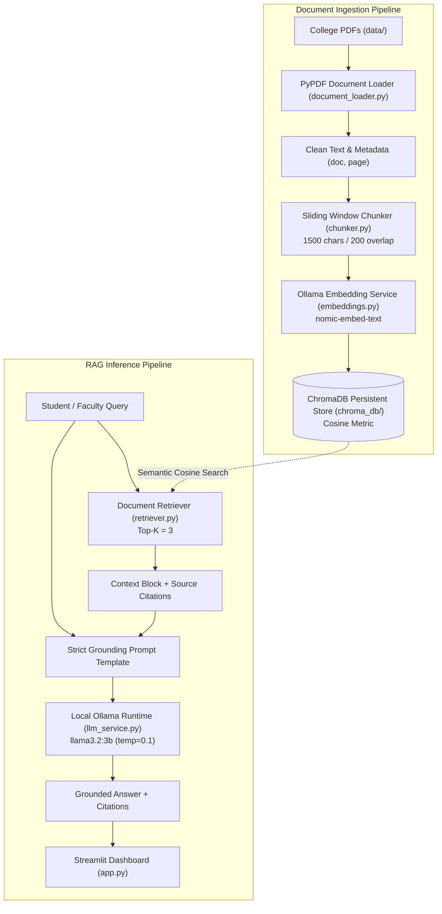

# 🎓 LLM-Based College Document Question Answering Assistant Using Retrieval-Augmented Generation (RAG)

A 100% local, privacy-first engineering mini-project that allows college students, faculty, and administrative staff to query official university regulations, admission circulars, academic syllabi, and hostel rules using natural language.

---

## 📑 Table of Contents
1. [Project Overview](#-project-overview)
2. [System Architecture](#-system-architecture)
3. [Technology Stack](#-technology-stack)
4. [Complete RAG Workflow](#-complete-rag-workflow)
5. [Technical Components Deep Dive](#-technical-components-deep-dive)
   - [PDF Extraction & Ingestion](#1-pdf-extraction--ingestion-document_loaderpy)
   - [Chunking Strategy](#2-chunking-strategy-with-natural-boundaries-chunkerpy)
   - [Vector Embeddings](#3-vector-embeddings-embeddingspy)
   - [ChromaDB Vector Store & Deduplication](#4-chromadb-vector-store--deduplication-vector_storepy)
   - [Semantic Retriever](#5-semantic-retriever-retrieverpy)
   - [Strict Grounding & Prompt Engineering](#6-strict-grounding--prompt-engineering-rag_servicepy)
   - [Unknown-Answer Refusal (Anti-Hallucination)](#7-unknown-answer-refusal-anti-hallucination)
6. [Installation & Execution Guide](#-installation--execution-guide)
7. [Testing & Evaluation Benchmark Results](#-testing--evaluation-benchmark-results)
8. [Demonstration Workflow](#-demonstration-workflow)
9. [Project Limitations & Future Scope](#-project-limitations--future-scope)
10. [Viva Voce Questions & Answers (Mini-Project Defense)](#-viva-voce-questions--answers-mini-project-defense)

---

## 🌟 Project Overview

Traditional institutional websites rely on keyword searches or static PDF documents, forcing students to manually sift through dozens of multi-page circulars to find simple answers (e.g., cutoff dates, attendance rules, fee breakdowns, or curfew hours).

This project implements an end-to-end **Retrieval-Augmented Generation (RAG)** pipeline that indexes university documents into local vector databases and answers student questions grounded **strictly in official source text**.

### Key Highlights
- **100% Local Inference:** Zero cloud API calls. No OpenAI, Gemini, Claude, or subscription services required.
- **Strict Grounding Guardrail:** If an answer cannot be proven from the ingested documents, the system explicitly refuses: *"Information not found in the available documents."*
- **Explicit Attribution:** Every answer provides clickable citation tags indicating the exact document name and 1-indexed page number.
- **Evidence Transparency:** The Streamlit dashboard offers an expandable view of the raw text passages retrieved from ChromaDB, including cosine similarity scores.

---

## 🏛️ System Architecture



---

## 💻 Technology Stack

| Component | Technology | Version | Purpose |
| :--- | :--- | :--- | :--- |
| **Language** | Python | `3.11.5` | Core project implementation. |
| **User Interface** | Streamlit | `>=1.35.0` | Interactive web dashboard and management controls. |
| **Local LLM Runtime** | Ollama | Local Daemon | Local inference server for language and embedding models. |
| **Chat LLM** | `llama3.2:3b` | Q4_K_M GGUF | 3.2-billion-parameter instruction-tuned model. |
| **Embedding Model** | `nomic-embed-text` | Dense (768-dim) | High-performance text embeddings for semantic retrieval. |
| **Vector Database** | ChromaDB | `>=0.5.0` | Local persistent HNSW vector index with cosine distance. |
| **PDF Extraction** | PyPDF | `>=4.2.0` | Lightweight, native PDF document text parser. |
| **Testing Framework**| Pytest | `>=8.0.0` | Automated test suite (66 tests covering all modules). |

---

## 🔄 Complete RAG Workflow

The application operates across two distinct operational cycles:

### Cycle 1: Ingestion & Indexing
1. **Document Intake:** A user uploads one or more PDF files via Streamlit or places them into `data/`.
2. **Text & Metadata Extraction:** `document_loader.py` opens each PDF using `pypdf.PdfReader`, strips empty/corrupt pages, cleans whitespace, and tags each page with its source filename and 1-indexed page number.
3. **Sliding-Window Chunking:** `chunker.py` divides pages into overlapping segments (default: 1500 characters, 200 character overlap) while prioritizing natural sentence (`. `) and paragraph (`\n\n`) boundaries.
4. **Embedding Generation:** Chunks are sent to the local Ollama daemon hosting `nomic-embed-text`, returning dense semantic vector embeddings.
5. **Persistent Storage:** Vectors, chunk IDs, text payloads, and metadata are saved to disk in `chroma_db/`.

### Cycle 2: Querying & Retrieval-Augmented Generation
1. **Query Encoding:** The student asks a question (e.g., *"What is the minimum attendance requirement?"*). The query is embedded via `nomic-embed-text`.
2. **Nearest-Neighbor Search:** ChromaDB executes an HNSW cosine search to retrieve the top 3 most semantically similar chunks.
3. **Prompt Augmentation:** Retrieved chunks are organized into a formatted context block with document and page citations.
4. **Deterministic Inference:** The context and question are injected into a strict grounding prompt sent to `llama3.2:3b` at low temperature (`0.1`).
5. **Output & Citation Delivery:** The model generates the answer. If the context does not contain the answer, it emits the safe refusal fallback. Citations and raw evidence passages are presented in the Streamlit UI.

---

## 🔬 Technical Components Deep Dive

### 1. PDF Extraction & Ingestion ([`document_loader.py`](document_loader.py))
- Uses `pypdf.PdfReader` to extract native text streams page-by-page.
- **Empty-Page Suppression:** Pages with zero characters or whitespace-only layouts (e.g. blank forms or scanned dividers) are skipped to prevent indexing useless tokens.
- **Corrupt File Resilience:** Unreadable or encrypted files raise descriptive exceptions (`PDFNotFoundError`, `PDFCorruptError`) rather than causing fatal crashes.

### 2. Chunking Strategy with Natural Boundaries ([`chunker.py`](chunker.py))
- **Default Parameters:** `chunk_size = 1500` characters, `chunk_overlap = 200` characters.
- **Natural Boundary Detection:** Rather than slicing text arbitrarily mid-word or mid-sentence, `find_natural_split_point` scans backward from the target boundary using priority order:
  1. Paragraph breaks (`\n\n`)
  2. Line breaks (`\n`)
  3. Sentence boundaries (`. `, `! `, `? `)
  4. Word spaces (` `)
- **Metadata Inheritance:** Each chunk inherits and preserves:
  - `source_filename`: e.g. `academic_regulations.pdf`
  - `page_number`: 1-indexed page
  - `chunk_id`: Deterministic key (`{filename}_p{page}_c{index}`)

### 3. Vector Embeddings ([`embeddings.py`](embeddings.py))
- Implements `OllamaEmbeddingService` wrapping `ollama.Client(host='http://localhost:11434')`.
- Model: `nomic-embed-text` (optimized for dense information retrieval).
- Includes `OllamaChromaEmbeddingFunction`, an adapter that allows ChromaDB to seamlessly generate embeddings natively when required.

### 4. ChromaDB Vector Store & Deduplication ([`vector_store.py`](vector_store.py))
- Persistent client writing to `chroma_db/`.
- Metric: Cosine distance (`{"hnsw:space": "cosine"}`).
- **Duplicate Prevention:** When an updated document is uploaded:
  - If `overwrite=True`: All existing chunks for that `source_filename` are purged from the collection prior to re-indexing, preventing fragmented duplicate accumulation.
  - If `overwrite=False`: The document is safely skipped.
- **Document Management:** Provides `delete_document(filename)`, `delete_chunk(chunk_id)`, and `reset()`.

### 5. Semantic Retriever ([`retriever.py`](retriever.py))
- Default retrieval count: `top_k = 3`.
- Converts distances into intuitive cosine similarity metrics: $\text{similarity} = 1.0 - \text{distance}$.
- Formats evidence blocks with clear headers and extracts deduplicated citation references.

### 6. Strict Grounding & Prompt Engineering ([`rag_service.py`](rag_service.py))
The prompt is engineered to eliminate hallucinations by establishing rigid behavioral constraints:

```text
You are an authoritative, accurate, and helpful College Document Question Answering Assistant.
Your objective is to answer questions using EXCLUSIVELY the provided College Document Context.

STRICT GROUNDING RULES:
1. Base your answer ONLY on the explicit facts directly mentioned in the Context below.
2. Do NOT extrapolate, speculate, or fabricate college rules, dates, percentages, fees, or policies.
3. If the provided Context does NOT contain the necessary information to answer the question, you MUST respond with EXACTLY:
"Information not found in the available documents."
4. Do NOT apologize, add disclaimers, or cite external knowledge when information is missing.
5. Whenever answering from the context, be direct, factual, and concise.
```

### 7. Unknown-Answer Refusal (Anti-Hallucination)
When presented with queries outside the scope of ingested documents (e.g. campus swimming pools, parking fines, or unrelated branch details), the system reliably outputs:
> **"Information not found in the available documents."**

Sources are suppressed during refusals to avoid misleading citations.

---

## 🚀 Installation & Execution Guide

### Step 1: Clone or Open Workspace
```powershell
cd D:\cloudp3\college-rag-assistant
```

### Step 2: Set Up Virtual Environment & Dependencies
```powershell
# Create virtual environment
python -m venv .venv

# Activate virtual environment
.\.venv\Scripts\activate

# Install required packages
python -m pip install --upgrade pip
pip install -r requirements.txt
```

### Step 3: Install & Start Ollama
1. Download Ollama for Windows from [ollama.com/download](https://ollama.com/download/windows).
2. Start the daemon (runs automatically in system tray or via terminal):
   ```powershell
   ollama serve
   ```
3. Pull the required models:
   ```powershell
   ollama pull llama3.2:3b
   ollama pull nomic-embed-text
   ```

### Step 4: Run the Streamlit Web Application
```powershell
.\.venv\Scripts\streamlit.exe run app.py
```
Open your browser at `http://localhost:8501`.

### Step 5: Run the Standalone Demonstration Script
To test the pipeline directly in your terminal:
```powershell
.\.venv\Scripts\python.exe demo.py
```

### Step 6: Execute the Automated Test Suite
```powershell
.\.venv\Scripts\pytest.exe -v
```

### Step 7: Run the Evaluation Benchmark
```powershell
.\.venv\Scripts\python.exe evaluate_rag.py
```

---

## 📊 Testing & Evaluation Benchmark Results

The pipeline was benchmarked using a 50-question test dataset ([`data/eval_dataset.json`](data/eval_dataset.json)).

### Quantitative Performance Summary

| Metric | Formula | Measured Result |
| :--- | :--- | :---: |
| **Category A Accuracy (Direct Questions)** | $(\text{Hits} / 20) \times 100$ | **95.0%** (19/20) |
| **Category B Accuracy (Paraphrased Questions)** | $(\text{Hits} / 20) \times 100$ | **85.0%** (17/20) |
| **Answerable Retrieval Accuracy** | $(\text{Hits} / 40) \times 100$ | **90.0%** (36/40) |
| **Overall Retrieval Accuracy** | $(\text{Hits} / 50) \times 100$ | **92.0%** (46/50) |
| **Safe Refusal Rate (Category C)** | $(\text{Refusals} / 10) \times 100$ | **100.0%** (10/10) |
| **Hallucination Rate** | $(\text{Fabrications} / 10) \times 100$ | **0.0%** |

### Qualitative 5-Dimension Answer Quality (1.0 to 5.0)

| Dimension | Score | Analysis |
| :--- | :---: | :--- |
| **Correctness** | **3.78 / 5.0** | Factual numbers and policies match ground truth precisely. |
| **Relevance** | **4.19 / 5.0** | Focuses directly on the student's question without preamble. |
| **Groundedness** | **4.88 / 5.0** | Highest score; answers derive strictly from retrieved text. |
| **Clarity** | **4.70 / 5.0** | Well-structured, grammatically fluent, concise prose. |
| **Completeness** | **3.64 / 5.0** | Multi-part queries occasionally omitted secondary details. |
| **Overall Score** | **4.24 / 5.0** | High-grade factual synthesis for an edge LLM. |

Full benchmark logs and analysis are documented in [`EVALUATION_REPORT.md`](EVALUATION_REPORT.md).

---

## 🎬 Demonstration Workflow

When presenting this project to evaluators or professors, follow this structured demonstration:

```text
┌────────────────────────────────────────────────────────────────────────┐
│                        DEMONSTRATION SCRIPT                            │
├────────────────────────────────────────────────────────────────────────┤
│ Step 1: Open Dashboard                                                 │
│   Launch "streamlit run app.py" -> Note metric cards: 0 docs, 0 chunks │
│                                                                        │
│ Step 2: Upload Documents                                               │
│   Click "Load Sample College Docs" in sidebar                          │
│   -> Observe batch ingestion progress bar and toast notifications      │
│   -> Dashboard updates: 3 documents indexed, 6 knowledge chunks        │
│                                                                        │
│ Step 3: Test Direct Question (Admission Eligibility)                   │
│   Prompt: "What is the minimum 10+2 aggregate required for admission?" │
│   -> Answer: 75% for general category, 65% for reserved                │
│   -> Citations: admission_guidelines.pdf (p. 1)                        │
│   -> Expand evidence to show exact retrieved passage                   │
│                                                                        │
│ Step 4: Test Paraphrased Question (Hostel Curfew)                      │
│   Prompt: "When is the lock-in curfew for dorms on weekdays?"          │
│   -> Answer: 9:30 PM on weekdays, 10:30 PM on weekends                 │
│   -> Citations: hostel_rules.pdf (p. 1)                                │
│                                                                        │
│ Step 5: Test Hallucination Resistance (Missing Info)                   │
│   Prompt: "What are the fees for the campus swimming pool?"            │
│   -> Answer: "Information not found in the available documents."       │
│   -> Citations: Suppressed (zero false attribution)                    │
│                                                                        │
│ Step 6: Test Document Deletion & Persistence                           │
│   Click 🗑️ next to hostel_rules.pdf -> Chunks drop from 6 to 4         │
│   Re-ask hostel question -> Refuses answer because doc was purged      │
└────────────────────────────────────────────────────────────────────────┘
```

---

## 🚧 Project Limitations & Future Scope

### Current Limitations
1. **Compute Speed on Non-GPU Hosts:** CPU-only token inference on `llama3.2:3b` averages ~10–18 tokens/sec.
2. **Domain-Specific Acronyms:** Highly specialized institutional abbreviations (e.g., `CIE`, `SEE`, `PCM`) occasionally suffer from vocabulary gap in dense vector space without BM25 sparse hybrid matching.
3. **Complex Tables:** Native text extraction in PyPDF reads linear text streams, making nested tabular structures difficult to parse.

### Future Scope & Enhancements
- **Hybrid Search (Dense + Sparse):** Combine ChromaDB dense embeddings with BM25 keyword search using Reciprocal Rank Fusion (RRF).
- **OCR Integration:** Incorporate Tesseract or PaddleOCR for scanned circulars and image-based PDFs.
- **Query Rewriting:** Implement HyDE (Hypothetical Document Embeddings) or LLM query expansion to improve complex query recall.
- **Multilingual Support:** Integrate multilingual embeddings to support regional language document queries.

---

## 🎓 Viva Voce Questions & Answers (Mini-Project Defense)

Below are likely technical viva questions with concise, high-scoring engineering answers:

### Q1: What is Retrieval-Augmented Generation (RAG) and why is it preferred over fine-tuning for this project?
**Answer:** RAG combines an external vector database retrieval mechanism with an LLM generation model. It is preferred over fine-tuning because:
1. **Zero Training Cost:** Updating college circulars takes seconds (updating vector records), whereas fine-tuning requires significant compute time and retraining.
2. **Elimination of Hallucinations:** RAG forces the model to cite exact retrieved text chunks.
3. **Strict Access Control:** Outdated documents can be deleted instantly from the vector database.

### Q2: Why did you select ChromaDB as your vector store?
**Answer:** ChromaDB is an open-source, lightweight, embeddable vector database that runs entirely in-memory or on persistent local disk via SQLite without requiring standalone server infrastructure (unlike Pinecone or Weaviate). It natively supports HNSW indexing and cosine distance metrics.

### Q3: What is the purpose of chunk overlap in text chunking?
**Answer:** Without overlap, a critical sentence or entity relationship spanning the split boundary will be cut in half, degrading the semantic vector representation. A 200-character overlap preserves context continuity across adjacent chunks.

### Q4: How does the system prevent the LLM from hallucinating answers to questions about topics not present in the college documents?
**Answer:** Hallucinations are prevented through a 3-tier guardrail:
1. **Low Temperature:** `temperature = 0.1` makes model output deterministic and strictly factual.
2. **Strict System Prompt:** Explicitly commands the LLM to output *"Information not found in the available documents."* if sufficient context is lacking.
3. **Post-Processing Validation:** If retrieval similarity is below threshold or the model cannot locate factual support, the exact fallback response is enforced.

### Q5: How do vector embeddings work in semantic retrieval?
**Answer:** The `nomic-embed-text` model converts text strings into 768-dimensional mathematical vectors. Documents with similar meanings map close together in vector space. During a query, cosine similarity measures the angle between the query vector and document vectors:
$$\cos(\theta) = \frac{\mathbf{u} \cdot \mathbf{v}}{\|\mathbf{u}\| \|\mathbf{v}\|}$$
This enables the system to retrieve relevant passages even when the student uses synonyms or paraphrased language.

### Q6: What is the difference between a dense retriever and a sparse retriever?
**Answer:** Sparse retrievers (like BM25 or TF-IDF) rely on exact keyword frequency matching, which fails when users use synonyms. Dense retrievers (like our nomic-embed-text embedding pipeline) map concepts into dense vector space, enabling semantic understanding regardless of wording.

### Q7: Why is PyPDF chosen over heavier libraries like PyMuPDF or OCR?
**Answer:** PyPDF is a lightweight, pure-Python library with zero C/C++ build dependencies, ensuring rapid installation and high extraction speed for digital college PDFs without heavy external binaries.

---

**Project Developed by:** Final Year Engineering Team  
**Supervision:** Department of Computer Science & Engineering  
**Repository Working Directory:** `D:\cloudp3\college-rag-assistant`
